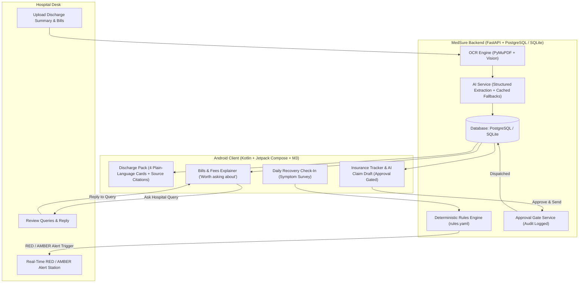

# MedSure — After-Discharge Healthcare Coordination System

> **Team PowerBank** | Hackathon MVP Project  
> *Closing the post-discharge gap between Patient, Family Caregiver, and Hospital Desk.*

---

## 1. Executive Summary

When patients are discharged from the hospital, families often experience a critical **post-discharge gap**:
- Complex discharge papers filled with medical jargon and unclear medication regimens.
- Unclear hospital bills with duplicate fees or administrative charges.
- Denied insurance claims due to missing investigation reports or missing pages.
- Unmonitored home recovery where subtle warning symptoms escalate into emergencies.

**MedSure** unifies the **Patient**, **Family Caregiver**, and **Hospital Desk** into a **single shared case**. It empowers families with verified plain-language discharge instructions, itemized bill explanations with "Worth asking about" inquiry gates, human-in-the-loop insurance claim drafting, and deterministic daily symptom monitoring with immediate hospital alert dispatch.

---

## 2. Core Journey & Architecture



---

## 3. Tech Stack

### Android Client
- **Language**: Kotlin 2.0
- **UI Toolkit**: Jetpack Compose with Material 3
- **Architecture**: MVVM with Repository Pattern & Reactive StateFlow
- **Navigation**: Jetpack Navigation Compose
- **Networking**: Retrofit 2.11 + OkHttp 4.12 + Logging Interceptor
- **Serialization**: Gson / Kotlinx Serialization
- **Design System**: Calm, modern, trustworthy healthcare aesthetics with accessible status indicators and verifiable document citation modals.

### Backend Server
- **Language & Framework**: Python 3.13 + FastAPI + Uvicorn
- **ORM & Migrations**: SQLAlchemy 2.0 + Alembic
- **Database**: Dual PostgreSQL (Docker/Cloud) & SQLite (Immediate Zero-Setup Local Dev & Automated Testing)
- **Security & RBAC**: PyJWT (HS256) + Bcrypt Password Hashing + Role-Based Dependencies
- **Document Processing & OCR**: PyMuPDF (Fitz) with per-page text extraction and confidence scoring (< 0.70 flagged for manual verification)
- **AI Service Abstraction**: Structured Pydantic validation with 100% deterministic cached fallbacks (ensuring zero failure without API keys)
- **Deterministic Rules Engine**: `rules.yaml` evaluator for emergency and caution triage (AI **never** makes independent medical diagnoses)
- **Approval Gate**: Human-in-the-loop audit logging for all outbound claim transmissions
- **Notifications**: In-app polling queue with Firebase Cloud Messaging (FCM) abstraction

---

## 4. Seeded Demo Accounts

All roles share Case **`MS-001`** at **MedSure Trust Hospital**.

| Role | Email | Password | Permissions & Workflow |
| :--- | :--- | :--- | :--- |
| **PATIENT** | `patient@medsure.demo` | `MedSure2026!` | View own case, discharge pack, bills, complete daily recovery check-in |
| **FAMILY** | `family@medsure.demo` | `MedSure2026!` | View case, ask bill questions, review AI claim drafts, **approve & send claims** |
| **HOSPITAL_DESK** | `hospital@medsure.demo` | `MedSure2026!` | Review all cases, process discharges, reply to queries, receive **RED/AMBER alerts** |

---

## 5. End-to-End 10-Step Demo Walkthrough

1. **Step 1 — Login as Hospital Desk**:
   - Open Android App (or visit Swagger API at `http://localhost:8000/docs`).
   - Tap **"Hospital Desk (hospital@medsure.demo)"** 1-tap login.
   - Open **Discharges** -> Tap **"Process OCR & AI"** for Case `MS-001`.
2. **Step 2 — Backend OCR & AI Extraction**:
   - Backend extracts text using PyMuPDF and validates structured JSON into 4 cards with source document page references.
3. **Step 3 — Login as Family / Patient**:
   - Switch user to **Anita Sharma (Family)**.
   - Open **Discharge Pack** -> Inspect the 4 cards:
     1. *What happened* (STEMI angioplasty with stent placement)
     2. *What to take* (Metformin, Atorvastatin, Dual Antiplatelets)
     3. *When to return* (7 days Cardiology OPD)
     4. *What to watch for* (Shortness of breath, chest pressure)
   - Tap **"View source (p.1)"** -> Verified original excerpt modal pops up.
4. **Step 4 — Review Itemized Bills**:
   - Open **Bills & Fees**.
   - Locate the flagged line: `Administrative & Documentation Handling Fee (₹8,500)` marked with amber badge: **"Worth asking about"**.
   - Tap **"Ask Hospital"** -> Submit question: *"Can you please clarify what is included under this administrative fee?"*
5. **Step 5 — Hospital Desk Replies to Query**:
   - Switch profile to **Hospital Desk**.
   - Open **Queries** -> View exact bill item, patient name, and question.
   - Tap **"Reply to Family"** -> Send response explaining digital records consolidation.
   - Switch back to Family -> Verify reply is instantly displayed.
6. **Step 6 — Insurance Checklist & Missing Documents**:
   - Open **Insurance Tracker**.
   - Current claim `CLM-2026-001` is marked **DENIED**.
   - Checklist displays missing `Catheterization & ECG Investigation Reports` and detects page gap on Discharge Summary (`3 of 4 pages uploaded`).
7. **Step 7 — AI Claim Draft & Family Approval Gate**:
   - Tap **"Generate AI Claim Draft"**.
   - Review draft letter addressed to Star Health Insurance containing complete clinical justification and attached documents.
   - Notice safety banner: **"AI-generated draft — review before approval."**
   - Tap **"APPROVE & SEND TO INSURER"**.
   - Audit record is created in database, status transitions to **REIMBURSEMENT**, and hospital desk receives notification.
8. **Step 8 — Daily Recovery Check-in**:
   - Switch to **Rajesh Sharma (Patient)**.
   - Open **Check-In** -> Select pain level, no fever.
   - Set **"Are you experiencing difficulty breathing?" = YES**.
   - Tap **"SUBMIT TODAY'S CHECK-IN"**.
9. **Step 9 — Deterministic Rules Engine Execution**:
   - Rules engine evaluates condition `breathing_difficulty == true` against `rules.yaml` without LLM diagnosis.
   - Triggers `BREATHING_001` with **RED ALERT** severity.
10. **Step 10 — Hospital Desk Receives Emergency Alert**:
    - Switch to **Hospital Desk**.
    - Open **Clinical Alerts**.
    - Immediately see 🔴 **RED ALERT**: *Patient reported difficulty breathing during today's check-in.*

---

## 6. Project Structure

```
medsure/
├── android/                             # Android Client (Kotlin + Compose + M3)
│   ├── app/
│   │   ├── src/main/java/com/powerbank/medsure/
│   │   │   ├── data/
│   │   │   │   ├── api/                 # Retrofit Interfaces & OkHttp Client
│   │   │   │   ├── model/               # Kotlin Data Models
│   │   │   │   ├── repository/          # Repository with Offline Fallbacks
│   │   │   │   └── session/             # Session & Token Manager
│   │   │   ├── ui/
│   │   │   │   ├── theme/               # Healthcare Palette, Typography, Shapes
│   │   │   │   ├── components/          # Cards, Badges, Source Chips, Dialogs
│   │   │   │   ├── navigation/          # NavHost & Role-based Bottom Navigation
│   │   │   │   └── screens/
│   │   │   │       ├── common/          # Splash & 1-Tap Login
│   │   │   │       ├── patient/         # Home, Discharge, Bills, Insurance, CheckIn
│   │   │   │       ├── family/          # Caregiver Home & Approval Portal
│   │   │   │       └── hospital/        # Discharges, Queries, Alerts Workstation
│   │   │   ├── viewmodel/               # StateFlow ViewModels
│   │   │   ├── MainActivity.kt
│   │   │   └── MedSureApplication.kt
│   │   └── build.gradle.kts
│   ├── settings.gradle.kts
│   └── build.gradle.kts
│
├── backend/                             # Python FastAPI Backend Server
│   ├── app/
│   │   ├── config.py                    # Pydantic Settings
│   │   ├── database.py                  # SQLAlchemy Engine & Session
│   │   ├── dependencies.py              # Common DB & RBAC Injectables
│   │   ├── models/                      # SQLAlchemy Entities (User, Case, Bill, etc.)
│   │   ├── schemas/                     # Pydantic Schemas & DTOs
│   │   ├── routers/                     # REST API Routers
│   │   ├── services/                    # Approval Gate, Seed Data
│   │   ├── rules/                       # Deterministic rules.yaml & Evaluator
│   │   ├── ai/                          # AI Service & Cached Clinical Fallbacks
│   │   ├── ocr/                         # PyMuPDF OCR & Confidence Scoring
│   │   ├── auth/                        # JWT & Bcrypt RBAC
│   │   ├── notifications/               # Polling Queue & FCM Abstraction
│   │   └── main.py                      # FastAPI App
│   ├── tests/                           # 40 Pytest Unit & Integration Tests
│   ├── alembic/                         # Alembic Migrations
│   ├── Dockerfile
│   └── requirements.txt
│
├── mock_data/                           # Synthetic Clinical Assets
│   ├── discharge/                       # Synthetic PDF & Scanned Image
│   ├── bills/                           # Synthetic Hospital Invoice JSON
│   └── claims/                          # Synthetic Insurance Claim JSON
│
├── docker-compose.yml
├── .env.example
├── .gitignore
└── README.md
```

---

## 7. Setup & Run Instructions

### 7.1 Backend Setup & Execution

#### Option A: Direct Local Run (Python 3.13)
```powershell
# 1. Navigate to backend directory
cd d:\MedSure\backend

# 2. Install dependencies
pip install -r requirements.txt

# 3. Apply database migrations
python -m alembic upgrade head

# 4. Start FastAPI server
python -m uvicorn app.main:app --host 0.0.0.0 --port 8000 --reload
```
- Open Swagger API Documentation: `http://localhost:8000/docs`
- Database automatically initializes and seeds `MS-001` with demo users.

#### Option B: Docker Compose (PostgreSQL + Backend)
```powershell
cd d:\MedSure
docker compose up --build
```
- PostgreSQL exposes port `5432`
- FastAPI backend exposes port `8000`

---

### 7.2 Running Backend Pytest Suite
```powershell
cd d:\MedSure\backend
python -m pytest -v
```
All **40 tests** run in under 4 seconds, verifying:
- Authentication & JWT token validation
- Role-based access control & case isolation
- Discharge pack extraction and verified source page linking
- Bill duplicate line and non-medical item detection ("Worth asking about")
- Bill query creation and hospital desk replies
- Insurance checklist, missing documents, and page gap detection
- **Strict approval gate**: claims cannot dispatch without explicit approval
- Deterministic rules engine: every rule in `rules.yaml` (breathing difficulty, high/moderate pain, fever, dizziness/vomiting, and free-text keywords: chest pain, breathless, bleeding, fainting)
- AI cached fallback: verified response generation even when API key is missing or calls fail
- OCR confidence scoring and low-confidence flagging

---

### 7.3 Android App Setup & Build

1. Open Android Studio and open the folder `d:\MedSure\android`.
2. Ensure JDK 21 is selected in **Settings -> Build, Execution, Deployment -> Build Tools -> Gradle -> Gradle JDK**.
3. Build the debug APK via Gradle:
   ```powershell
   cd d:\MedSure\android
   & "C:\Users\Hp\.gradle\wrapper\dists\gradle-9.3.1-bin\23ovyewtku6u96viwx3xl3oks\gradle-9.3.1\bin\gradle.bat" assembleDebug
   ```
4. Run on Android Emulator or physical device:
   - When running on Android Emulator, the app connects automatically to the local backend at `http://10.0.2.2:8000/`.
   - On physical devices, set `SessionManager.baseUrl` to your machine's LAN IP (e.g. `http://192.168.1.X:8000/`).

---

## 8. Clinical Guardrails & Design Philosophy

1. **Deterministic Rules vs. AI**:
   - AI is used solely for summarization and translation into plain language.
   - AI **never** diagnoses or assigns triage alert levels.
   - Medical alerts are evaluated deterministically from `rules.yaml` on structured answers and literal keyword matches.
2. **Human-in-the-Loop Gating**:
   - The insurer never receives unapproved AI claim drafts.
   - Outbound actions require explicit Family authorization which is committed to the database audit log.
3. **Source Linking Integrity**:
   - Every card displayed to patients retains document and page citations (`View source (p.X)`).
   - Prevents medical hallucinations and instills clinical trust.
4. **Resilient Offline Fallback**:
   - The Android client and backend function deterministically even without an active internet connection or third-party AI keys.
